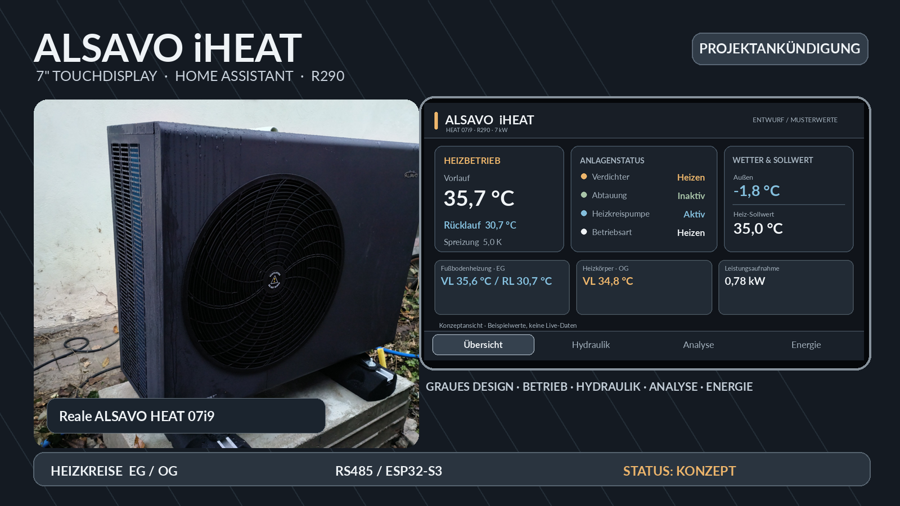
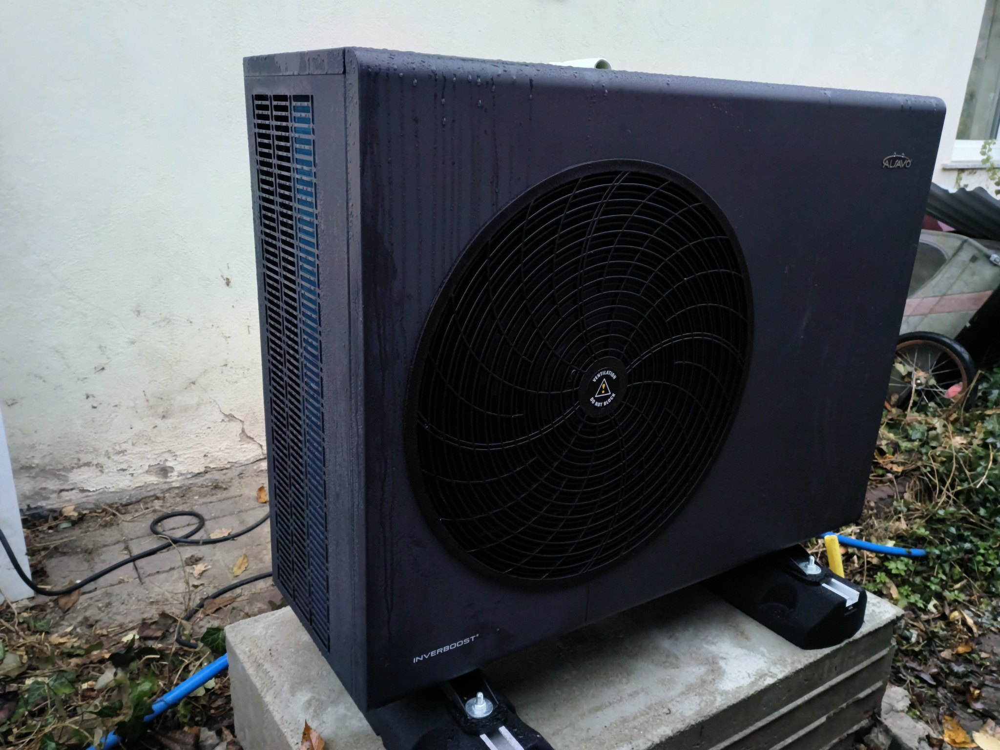
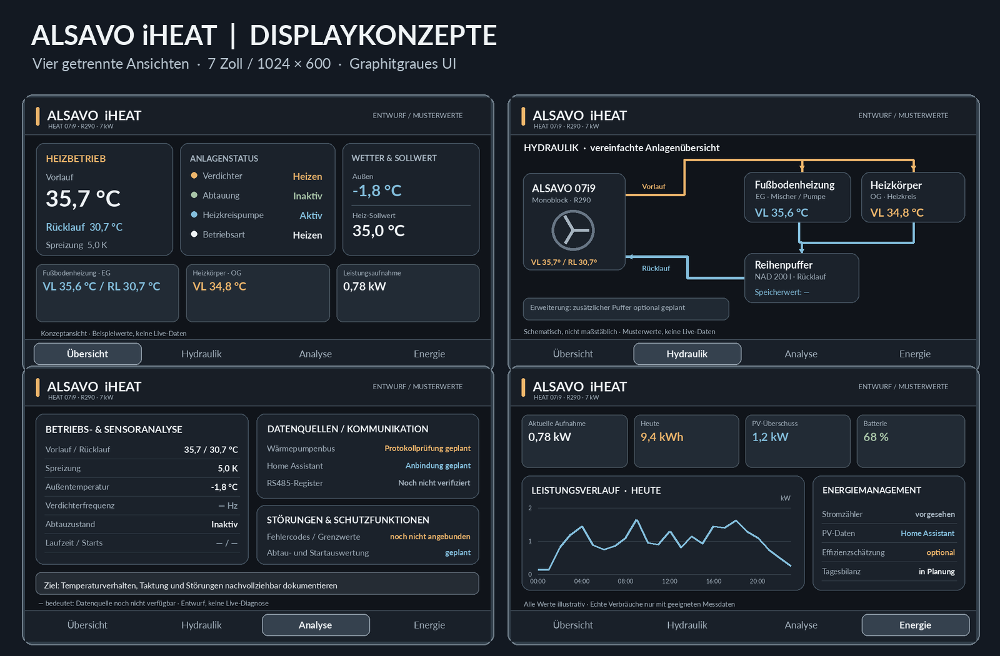
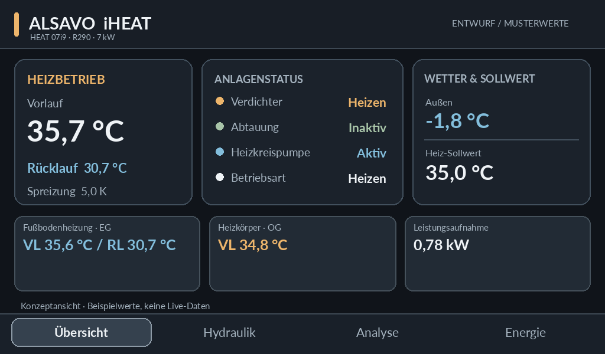
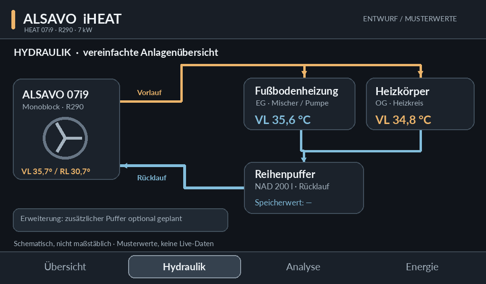
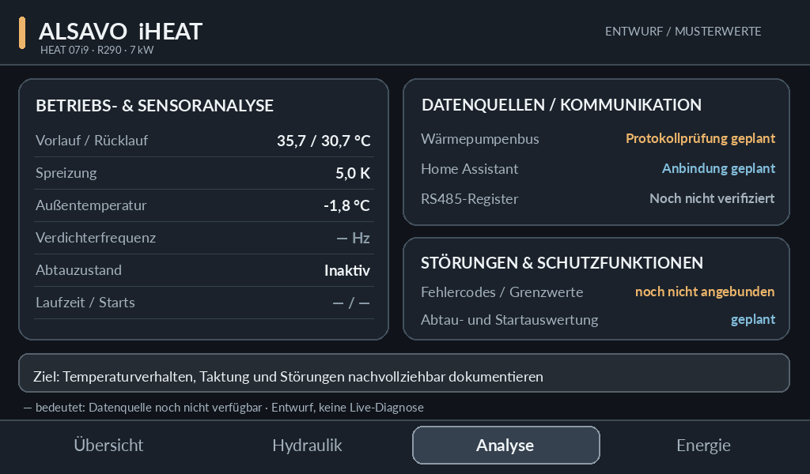
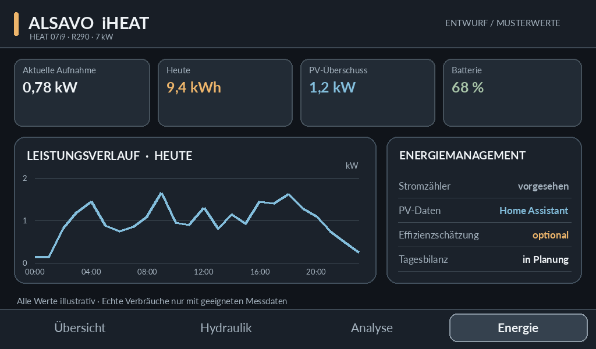
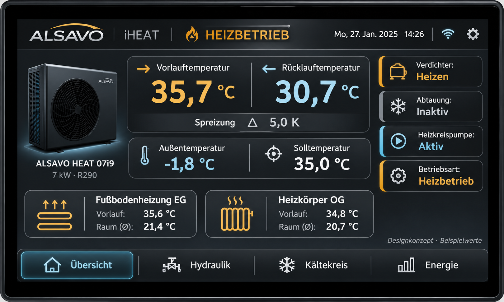
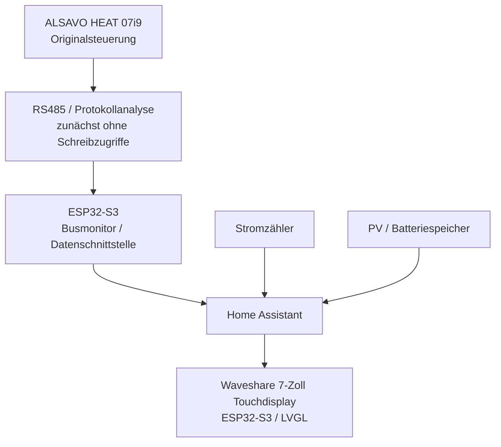

# ALSAVO iHEAT · 7" Touch Display

### Eigenes Wärmepumpen-Cockpit für Home Assistant

**Heizen verstehen. Hydraulik sichtbar machen. Energieverbrauch analysieren.**

> [!IMPORTANT]
> **Projektstatus: Konzeptphase (November 2026).** Diese README ist eine Vorankündigung. Die dargestellten Temperatur- und Energiewerte sind **Beispielwerte**. Es existiert derzeit **keine hier veröffentlichte betriebsfertige Firmware** und keine bestätigte Registerbelegung für eine aktive ALSAVO-Steuerung. Die Entwürfe sind Visualisierungen, keine Screenshots aus dem Livebetrieb.

## Warum dieses Projekt?

Die **ALSAVO HEAT 07i9** ist eine R290-Luft/Wasser-Monoblock-Wärmepumpe mit nominell rund 7 kW Heizleistung. Das Projekt soll ihre technischen Betriebsdaten unabhängig und lokal in **Home Assistant** verfügbar machen und auf einem eigenen **7-Zoll-Touchdisplay** als grafisches Cockpit darstellen.

Der Schwerpunkt liegt auf dem **Heizbetrieb**: Vor- und Rücklauf, Spreizung, Verdichter, Abtauung, Heizkreise, Hydraulik, Stromverbrauch und perspektivisch die Effizienzbewertung. Die Warmwasserbereitung erfolgt in der beschriebenen Installation über eine **separate Brauchwasserwärmepumpe** und gehört daher nicht zur Hauptanzeige dieser ALSAVO-Oberfläche.

Optisch orientiert sich das Konzept an meinem Avarma-BWWP-Displayprojekt, verwendet hier jedoch ein eigenständiges **Graphit-/Silbergrau-Design** mit dezenten Akzenten für Wärme (Bernstein) und Rücklauf/Kälte (Eisblau).

## Reale Anlage und Hardware

**Praxisaufbau (vereinfacht):**

- **Wärmepumpe:** ALSAVO HEAT 07i9, R290-Monoblock, 7-kW-Klasse
- **Erdgeschoss:** Fußbodenheizung mit Mischer und eigener Umwälzpumpe
- **Obergeschoss:** Heizkörperkreis
- **Pufferspeicher:** NAD 200 l als Reihenpuffer im Rücklauf
- **Erweiterung:** zusätzlicher Pufferspeicher als mögliche spätere Ausbaustufe
- **Datenplattform:** Home Assistant
- **Busanbindung:** RS485-/Protokollanalyse geplant, konkrete Nutzbarkeit noch zu prüfen
- **Touchpanel:** vorgesehen ist ein Waveshare ESP32-S3-Touch-LCD-7B mit 1024 × 600 Pixeln; ESPHome/LVGL als bevorzugter technischer Ansatz, abhängig von der Praxistauglichkeit

## Erste Displaykonzepte

Die folgenden Ansichten sind **statische UI-Entwürfe in der nativen Zielauflösung 1024 × 600**. Die Texte und Messwerte sollen zeigen, wie die fertige Oberfläche wirken könnte.

### 1 · Betriebsübersicht

**Geplant:** Vorlauf, Rücklauf, Temperaturspreizung, Außentemperatur, Sollwert, Betriebszustand und Status von Verdichter, Abtauung und Heizkreispumpe. Die Zustände **Heizen**, **Bereitschaft**, **Abtauung** und **Störung** sollen klar unterscheidbar werden.

### 2 · Hydraulik und Heizkreise

**Geplant:** schematische Darstellung des Vor- und Rücklaufs, der Fußbodenheizung im Erdgeschoss, des Heizkörperkreises im Obergeschoss sowie des Reihenpuffers. Die Anzeige ist ein **Funktionsschema, keine hydraulische Montage- oder Ausführungszeichnung**.

### 3 · Analyse und Diagnose

**Geplant:** Temperaturverläufe, Verdichterfrequenz, Abtauereignisse, Verdichterstarts, Laufzeiten und Fehlerdiagnose, **soweit die Datenquellen tatsächlich verfügbar sind**. Fehlende Register werden ausdrücklich als nicht verfügbar markiert, nicht künstlich gefüllt.

### 4 · Energie und Effizienz

**Geplant:** elektrische Momentanleistung, Tages-/Monatsverbrauch, Lastverlauf, PV-Überschuss und Batteriespeicherstatus. COP-/Arbeitszahlwerte werden nur dann angegeben, wenn neben der elektrischen Leistung auch belastbare thermische Messwerte oder hinreichend transparente Schätzverfahren vorliegen.

### Optionale 3D-Designstudie

*Zusätzliche grafische Designstudie; alle dort gezeigten Werte und Bedienelemente sind illustrativ.*

## Geplante Systemarchitektur

**Wichtig:** Das Schema beschreibt die angestrebte Architektur. Eine funktionierende und freigegebene ALSAVO-RS485-/Modbus-Anbindung wird hier **nicht vorweggenommen**. Der vorhandene Regler soll zunächst unverändert bleiben. Aktive Schreibzugriffe und Parameteränderungen sind gesondert zu verifizieren und sicherheitstechnisch zu bewerten.

## Geplante Funktionen

| Bereich | Ziel |
|---|---|
| Betrieb | Klarer Heiz-, Bereitschafts-, Abtau- und Fehlerstatus |
| Temperaturen | Vorlauf, Rücklauf, Spreizung, Außentemperatur und Sollwert |
| Heizkreise | FBH EG, Heizkörper OG, Umwälzpumpen und Mischer, soweit messbar |
| Analyse | Verdichterstarts, Laufzeiten, Abtauungen und Zeitreihen |
| Energie | Elektrischer Verbrauch, PV-Daten und optional Effizienzkennzahlen |
| Bedienung | Spätere Touch-Steuerung nur für bestätigte und zulässige Funktionen |
| Wartung | Kommunikationsstatus, Ausfälle und Sensor-Plausibilität |

## Roadmap

- [x] Reale ALSAVO HEAT 07i9 als Projektgrundlage dokumentiert
- [x] Eigenständiges graues UI-Design für vier Displayseiten erstellt
- [x] Hydraulikschema der Heizkreise als Konzept visualisiert
- [x] GitHub-Vorankündigung mit realem Gerätefoto vorbereitet
- [ ] Display-Hardware und ESPHome-/LVGL-Kaltstartverhalten testen
- [ ] ALSAVO-Schnittstelle und Busprotokoll zuverlässig identifizieren
- [ ] Lesende Datenanbindung an Home Assistant nachweisen
- [ ] Echte Sensorwerte und Energiezähler zuordnen
- [ ] Betriebszustände und Abtauereignisse validieren
- [ ] Bedienung und Parametrierung nur nach geprüfter Freigabe entwickeln
- [ ] Langzeittest, Dokumentation und erste veröffentlichbare Version

## Technische Hinweise

Die Vorankündigung ist **kein Schaltplan und keine Anleitung zum Eingriff in das Kältesystem**. Die R290-Anlage enthält ein brennbares Kältemittel und elektrische Komponenten. Änderungen an Steuerung oder elektrischen Anschlüssen dürfen die Schutzfunktionen des Herstellers nicht beeinträchtigen. Einstellungen, Messungen und Eingriffe an sicherheitsrelevanten Komponenten gehören in qualifizierte Hände.

**Datenqualität geht vor Grafik:** Wo Register fehlen, Sensoren unbekannt sind oder berechnete Arbeitszahlen nicht validiert wurden, zeigt die spätere Oberfläche einen entsprechenden Hinweis an.

## Links und Quellen

- [Hersteller: ALSAVO HEAT 07i9](https://www.alsavo.com/de/products/alsavo-r290-7kw-air-source-heat-pump-monoblock-inverboost-multifunctional-hot-water)
- [Heat Pump KEYMARK – ALSAVO HEAT 07i9](https://www.heatpumpkeymark.com/en/?cHash=70cd73849c9959f126bb721de04cb8f7&tx_pskeymark_frontend%5Baction%5D=generatePdf&tx_pskeymark_frontend%5Bcontroller%5D=Frontend&tx_pskeymark_frontend%5Bsubtype%5D=5571&type=109126)
- [ESPHome](https://esphome.io/) · [Home Assistant](https://www.home-assistant.io/)
- [Entwicklerprofil AWendt206](https://github.com/AWendt206)

---

**Unabhängiges Community-Projekt.** Keine offizielle Software von ALSAVO, Waveshare, ESPHome oder Home Assistant. Fortsetzung und erste technische Ergebnisse folgen in diesem Repository.
